# Cabinet Studio how-to

For **Warren Williams** on this PC. Plain steps with real screenshots from the app.

**Where this guide lives**

`C:\Users\spart\OneDrive\Desktop\CabinetStudio\docs\how-to\`

**App**

- Desktop shortcut: **Cabinet Studio**
- Exe: `C:\Users\spart\OneDrive\Desktop\CabinetStudio\builds\CabinetStudio\CabinetStudio.exe`
- Sample cabinet: `C:\Users\spart\OneDrive\Desktop\CabinetStudio\saves\sample-motor-cabinet.cabinet.json`

---

## Important (read once)

- **Drawings are a design aid.** They are **not** a certified UL 508A package.
- **Programming is learning / cut-and-paste text.** It is **not** a live PLC download.
- **You do not edit the SVG schematics by hand.** Change devices, wire numbers, and landings in the cabinet UI, then click **Drawings** again so Cabinet Studio regenerates the sheets.

---

## Left rail order (top → bottom)

After the rebuild, the left rail follows the job order:

1. **New build with AI**
2. **Open** / **Save**
3. **Save as**
4. **New**
5. **Guide build** / **AI suggest**
6. **Drawings** / **View drawings**
7. **Programming** / **Program stubs**
8. **Desktop shortcut**
9. **UL 508A review**
10. Layout templates and the equipment library (below; scroll if needed)

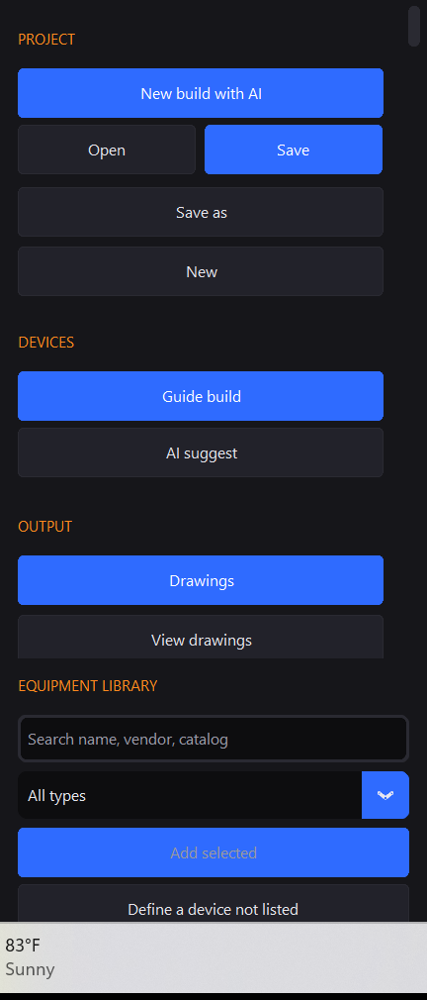

---

## A. Start Cabinet Studio

1. On your Desktop, double-click the **Cabinet Studio** shortcut.
2. The main window opens (dark theme, **CABINET STUDIO** header, empty or last panel in the center).

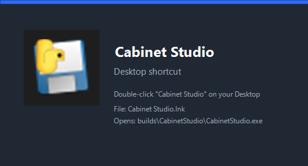

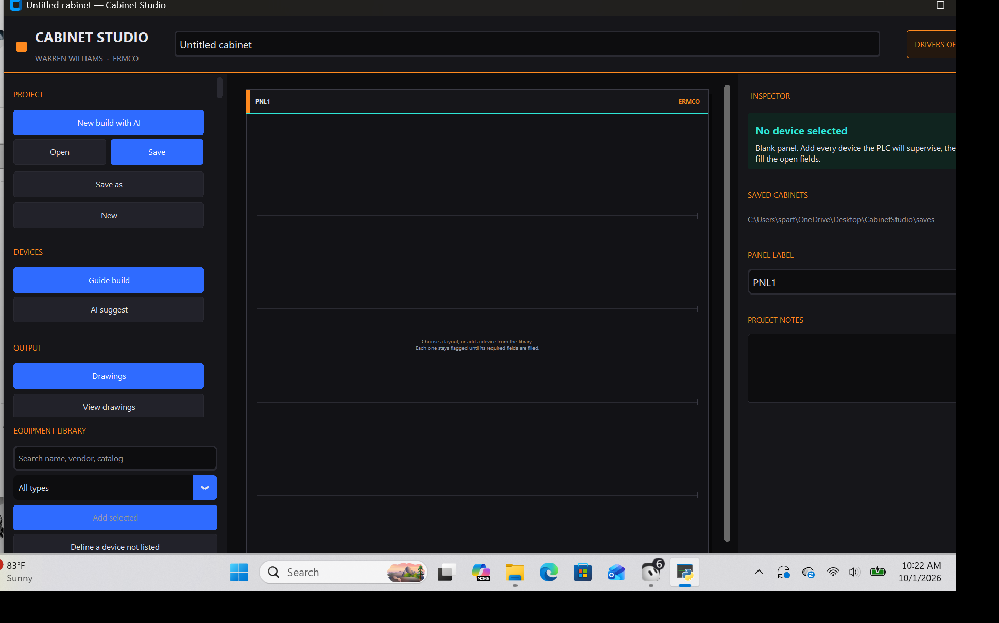

**If the shortcut is missing:** click **Desktop shortcut** on the left rail once, or run the exe path above.

---

## B. Open the sample cabinet

1. Click **Open** on the left rail (or press **Ctrl+O**).
2. Go to the outer saves folder:  
   `C:\Users\spart\OneDrive\Desktop\CabinetStudio\saves\`
3. Choose **sample-motor-cabinet.cabinet.json** and open it.
4. You should see panel **MCC1** with tiles like PSU1, PLC1, VFD1, MTR1, start/stop, e-stop.

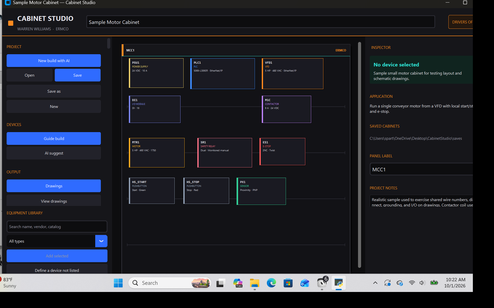

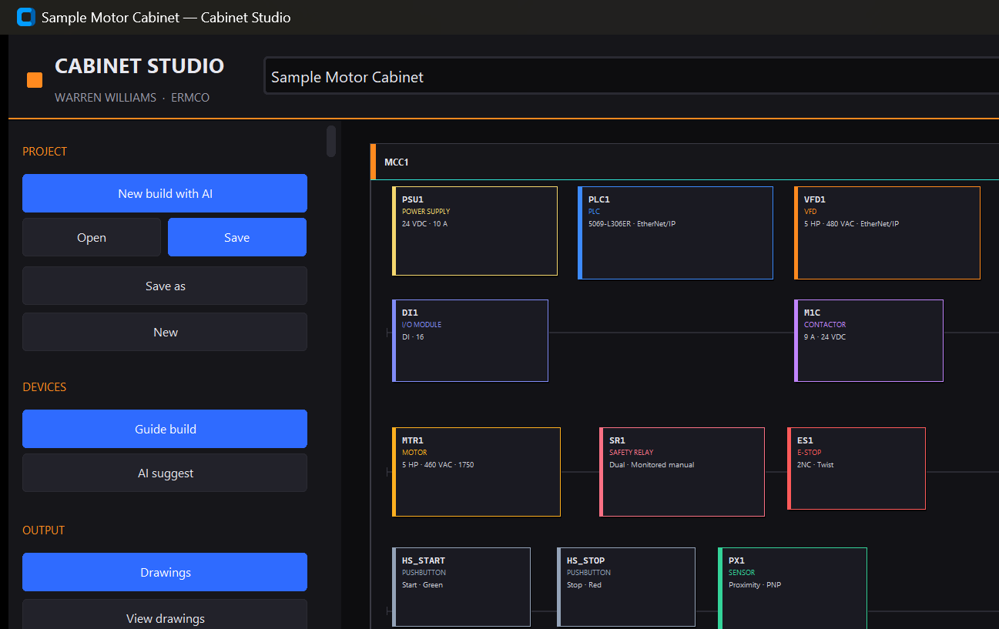

---

## C. Know the left rail buttons

| Button | What it does |
|--------|----------------|
| **New build with AI** | Guided path: interview → recommend → devices → save → drawings → programming (confirms between steps) |
| **Open** / **Save** / **Save as** | Load or write `*.cabinet.json` in the saves folder |
| **New** | Start a blank / template cabinet without the AI walk |
| **Guide build** / **AI suggest** | Interview + suggested parts, or suggest the selected device |
| **Drawings** | Generate layout + schematic SVGs from the cabinet |
| **View drawings** | Flip through sheets in the in-app viewer |
| **Programming** | Full-screen ladder / questions / Copy PLC / Print |
| **Program stubs** | Older stub browser (Logix / SCL / Modbus text) |
| **Desktop shortcut** | Recreate the Desktop shortcut |
| **UL 508A review** | Advisory checklist only (design aid) |

---

## D. Drawings — generate and flip sheets

1. With a cabinet that has devices, click **Drawings**.
2. Cabinet Studio writes SVG sheets under the drawings folder for this cabinet.
3. When prompted, click **View drawings** (or click **View drawings** on the rail anytime).
4. Use **Previous** / **Next** (or Left/Right arrows) to flip sheets.

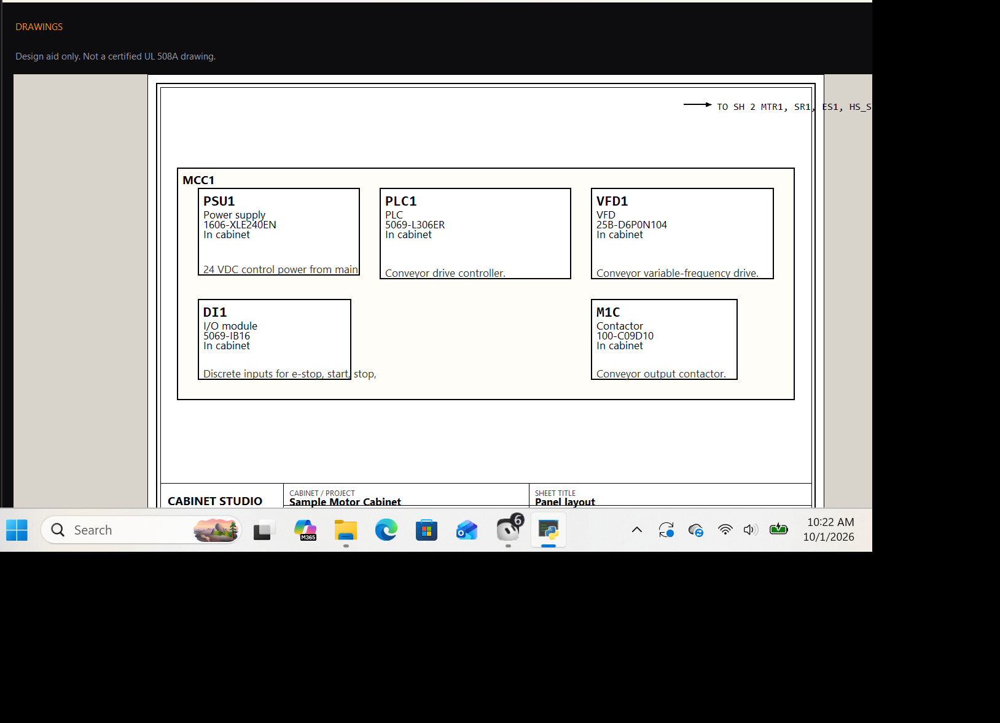

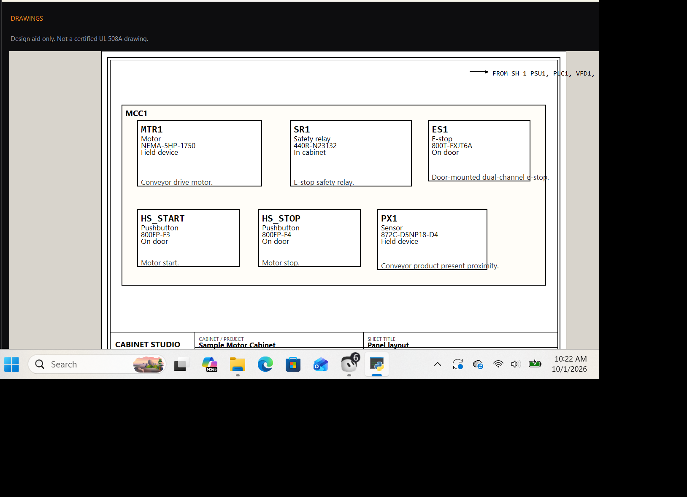

---

## E. How to edit drawings / schematics (honest answer)

**You edit the cabinet, not the SVG.**

1. Click a device tile on the panel (example: **PSU1**).
2. The right **Inspector** shows tag, description, vendor, catalog. Click **Edit definition** (or double-click the tile).
3. In the definition wizard, walk the steps. On the **Wiring** step you set:
   - **Terminal landings**
   - **Wire numbers**
   - **Wire color**
4. Finish/save the definition.
5. Click **Drawings** again so schematics regenerate from the updated cabinet.

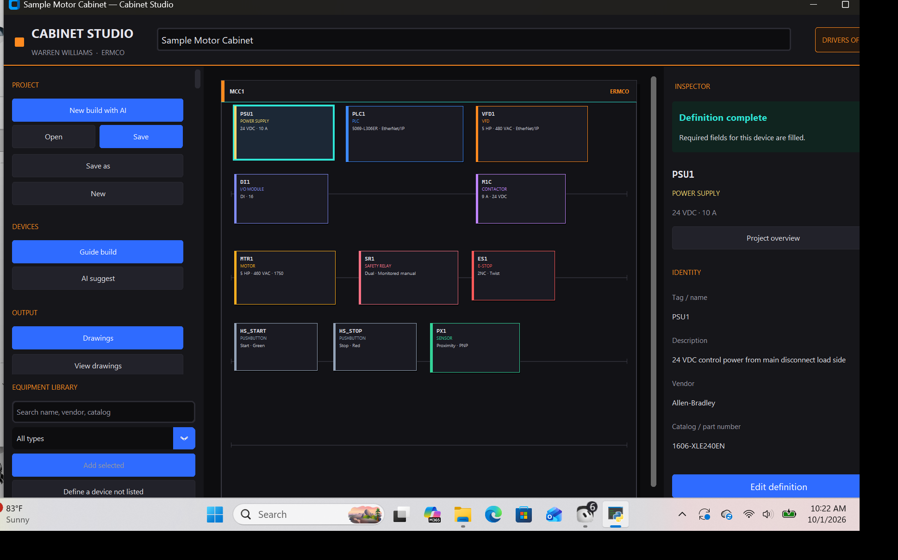

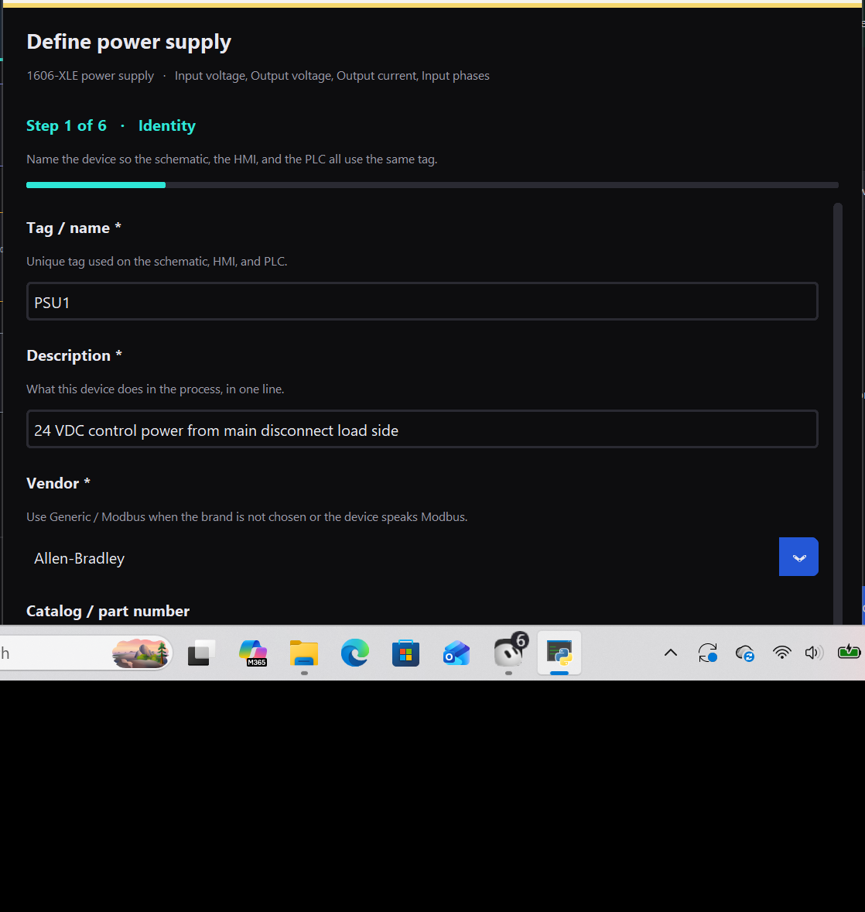

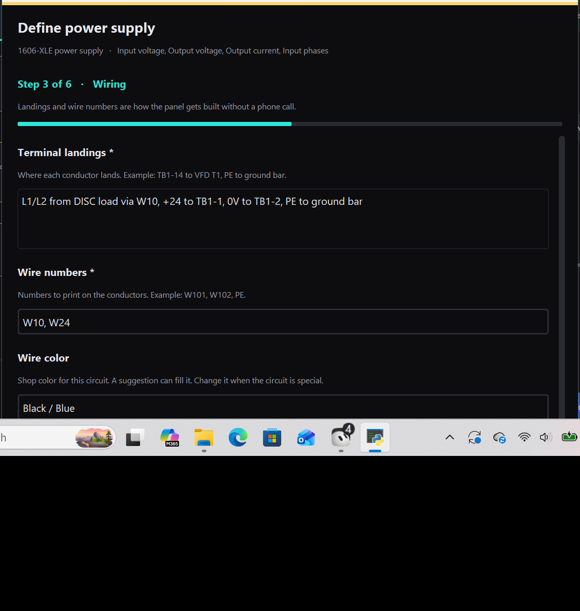

---

## F. Programming

1. Click **Programming** on the left rail (scroll the rail if you only see Drawings / View drawings).
2. A full-screen window opens. Sample already has a starter ladder.
3. Tabs / tools you will see:
   - **Ask questions** — rebuild from simple Q&A if you want a fresh starter
   - **Ladder** — readable contacts and coils
   - **PLC text** / **HMI text**
   - **Copy PLC** / **Copy HMI** / **Print**
4. To edit a rung: use the **RUNG EDITOR** bar (**Contact**, **Coil**, **Add rung**, **Add series contact**, **Delete rung**), or click a rung on the ladder.
5. Click **Done - return to cabinet** when finished.

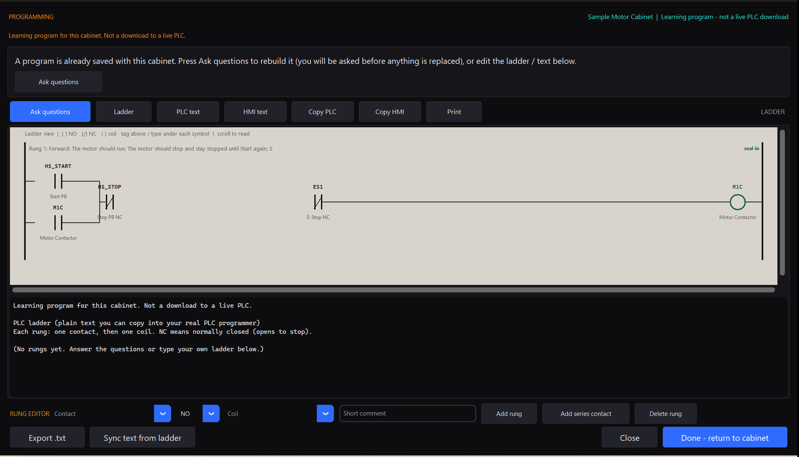

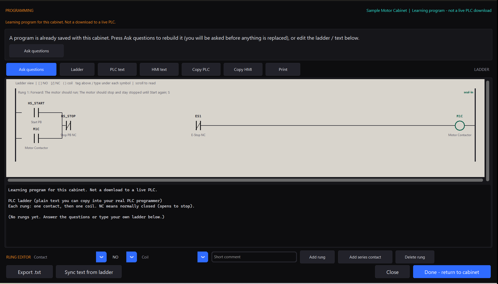

---

## G. New build with AI (optional full walk)

1. Click **New build with AI** at the top of the left rail.
2. Confirm **Start**.
3. Fill the **application interview** → save.
4. Confirm **Recommend** → pick layout/parts → define devices as prompted.
5. Confirm **Save** the cabinet JSON.
6. Confirm **Drawings** (design aid, not UL listing).
7. Confirm **Programming** (not a live PLC download).
8. You can **Stop here** / **Skip** at any confirm.

---

## Gaps / notes for Warren

- **01-desktop-icon.png** is a composed card from the real shortcut + exe icon (live Desktop Explorer capture was unreliable in automation). The real shortcut name on the Desktop is **Cabinet Studio**.
- Opening the sample by clicking **Open** yourself is the normal path; automation also loaded the sample for screenshots.
- If **Programming** is not visible, scroll the left rail down under **OUTPUT** (it sits under **View drawings**).
- No git commits were made as part of this guide.

---

*Cabinet Studio how-to — screenshots captured on Warren's PC against the rebuilt exe / matching UI.*
